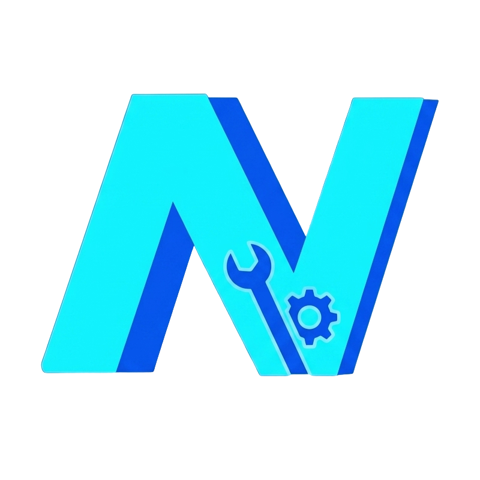

<p align="center">
  
</p>

<h1 align="center">Neodash Mod Loader</h1>

<p align="center">Install, manage, and switch UE4SS mods for Neodash on Windows.</p>

<p align="center">
  <a href="#getting-started">Getting started</a> ·
  <a href="#features">Features</a> ·
  <a href="#development">Development</a> ·
  <a href="https://github.com/Boosterfrank/Neodash-Mod-Loader/issues">Report an issue</a>
</p>

Neodash Mod Loader is a Windows desktop app for the Steam version of Neodash. Browse the mod library, import local packages, manage enabled mods, and keep different mod selections in named profiles. The app uses WinUI 3 and .NET 10, with a self-contained Windows x64 executable for distribution.

## Features

- **Install mods** from the built-in library, local ZIP archives, or folders. Drag and drop packages onto the installed-mod list.
- **Create Lua mods** with a named folder and starter `Scripts/main.lua`. Open a Lua mod's script folder directly in VS Code.
- **Manage your collection** with search, filters, bulk enable/disable actions, and direct access to mod folders and configuration files.
- **Update and recover** with library update checks, an Update all action, repair/reinstall for managed packages, and restoration from the last update backup.
- **Switch profiles** to apply different enabled-mod selections. Create, rename, delete, import, and export profiles.
- **Manage UE4SS** through setup and Settings: install, update, repair, remove, edit its configuration, and open diagnostic logs.
- **Protect existing data** with archive/path validation, package ownership checks, recovery snapshots, and transactional settings and profile writes.

PAK mod management is not implemented. The current installer supports UE4SS folder mods.

## Getting started

### Requirements

- Windows 10 or Windows 11 on x64.
- An installed Steam copy of Neodash.
- Internet access for library refreshes and package downloads. Local ZIP and folder imports do not require a download.

Published builds include the .NET and Windows App SDK runtimes; users do not need to install .NET separately. Building from source requires the SDK described under [Development](#development).

### Get a build

There are currently no published GitHub releases. Follow the [source build instructions](#development) to produce `artifacts/publish/Neodash Mod Loader.exe`.

The [Windows CI workflow](.github/workflows/ci.yml) also produces a `Neodash-Mod-Loader-win-x64` artifact after a successful run. Download and extract that artifact from the run's summary when one is available. CI artifacts are development builds.

### First launch

1. Run `Neodash Mod Loader.exe`.
2. Let the app detect Neodash through Steam, or use **Settings → Choose game folder**. You can select the installation root or its `Runway/Binaries/Win64` folder; the app checks for `Runway-Win64-Shipping.exe`.
3. Install UE4SS during setup, or use **Settings → Install / update / repair**. If you already have UE4SS installed, you can continue without installing it again.
4. Open **Mod Library** to browse and install mods, or use **Home → Add mod…** to install a local ZIP, import a folder, or create a Lua mod.
5. Select the mods you want enabled, choose **Save Changes**, and use **Launch Neodash**.

Close Neodash before creating, installing, updating, enabling, disabling, repairing, restoring, or removing mods.

## Using the loader

### Mod actions

Open a mod's action menu on **Home** to access its folder, configuration, repair, backup restore, or uninstall action.

| Action | Behavior |
| --- | --- |
| Enable / disable | Changes take effect after **Save Changes**. Disabled mods are kept in `DisabledMods` so they can be enabled again. |
| Open in VS Code | Opens the folder containing the mod's Lua entry point (`Scripts` or `Script`). Appears for Lua mods, including disabled and mixed Lua/DLL mods, and is disabled when VS Code isn't found. |
| Repair / reinstall | Reinstalls a package tracked by the loader using its recorded source. That source must still be available. |
| Restore last update backup | Restores the previous files and enabled state when a valid backup exists for that managed mod. |
| Uninstall | Permanently deletes the mod's enabled and disabled copies, including files inside those folders. For a tracked package with multiple mod folders, all of its folders are removed. |

Uninstall is not an undoable disable action. Keep a separate copy of any configuration or other files you want to retain before uninstalling.

### Creating a Lua mod

Choose **Home → Add mod… → Create Lua mod…**, enter a unique mod name, then choose **Create mod**. The loader creates `Mods/<name>/Scripts/main.lua`, registers it in `mods.txt`, and enables it in the active profile. The starter script prints a loaded message; add your own Lua code to it. Existing enabled or disabled folders and package-owned names are protected from replacement.

Use the mod's action menu → **Open in VS Code** to edit its script folder. The loader finds standard user/system VS Code installations and portable installations on `PATH`; installing VS Code is optional. You can also use **Open mod folder** and your preferred editor. Mod creation currently supports Lua only.

For Lua API examples and the script layout, see the official [UE4SS Lua mod guide](https://docs.ue4ss.com/dev/guides/creating-a-lua-mod.html).

Supported packages contain UE4SS mod folders, such as a folder with `Scripts/`, `Script/main.lua`, or `dlls/`. ZIP packages may contain several mod folders or a supported wrapper layout. Archives containing a single mod directly at the root can be imported with a chosen folder name. See the [installer](src/Neodash.ModLoader/Core/Mods/ModPackageInstaller.cs) for the exact validation rules.

The **Entry point** column shows a mod's native DLL, Lua script, or both. Package updates replace the old mod folders, removing obsolete DLLs while keeping supported user configuration and a recovery snapshot. UE4SS updates also remove obsolete runtime DLLs recorded for that game; unrelated DLLs and files inside user mod folders are preserved.

The version 1.4 single-EXE installer cleans up the known runtime sidecars and their empty language/runtime folders from older multi-file app installations after installing the new executable. Non-empty or unknown folders are retained. It preserves settings and profiles in `%LOCALAPPDATA%\Neodash Mod Loader`.

Downloads show transferred size, speed, percentage, and an approximate time remaining when the server supplies a total size. Operations support safe cancellation where available and report completion in a dismissible notice. Configuration editing uses a wider dialog and keeps your draft open if saving fails.

### Profiles

Use the profile controls on **Home** to save and switch enabled-mod selections. Profiles contain mod folder names, not mod files or configuration contents. Importing a profile does not download missing mods; install those packages separately.

### Shortcuts

| Shortcut | Action |
| --- | --- |
| `Ctrl+S` | Save pending enabled-mod changes on Home. |
| `F5` | Refresh the current Home or Mod Library list. |

## Settings and recovery

Application data is stored in:

```text
%LOCALAPPDATA%\Neodash Mod Loader\
```

| File or folder | Purpose |
| --- | --- |
| `settings.json` | App preferences, selected game path, and managed installation records. |
| `profiles.json` | Named profiles and the active profile. |
| `Backups/` | Mod snapshots used for update restoration and operation recovery. |
| `operations-*.log` | Installation, settings, and recovery diagnostics, rotated daily and at 10 MiB. |
| `crash.txt`, `crash_*.txt` | Unhandled exceptions, including inner exceptions and stack traces. |

Open these locations from **Settings → Diagnostics and recovery**. Mods themselves remain in the selected game's `Win64/Mods` and `Win64/DisabledMods` folders.

Logging uses Serilog with local-PC timestamps such as `[2026-10-15 04:27:01] [INF]`. Each log stream retains up to 14 files. Diagnostic buttons open the newest rolled file; the old `operations.log` remains available as a fallback. Settings → About shows the build's embedded Git commit as a GitHub link, with a **Copy** button for bug reports. Source builds without Git metadata show that the commit is unavailable.

Older settings and profiles are supported, including legacy installed-version keys and unknown settings fields. Settings resaved by version 1.3 after using a newer version are decoded on load; the next normal save writes installation lists and version mappings in the current format. If an existing settings or profile file cannot be read or validated, the app preserves it and blocks writes that would overwrite it. Back up the file before repairing it, and check the operation log for the reported error.

Settings and profiles use versioned storage contracts, independent of the app version. Unsupported newer schemas are preserved and cannot be overwritten. See the [settings format](docs/settings-format.md) and [profile format](docs/profiles-format.md) migration rules before changing persisted fields.

UE4SS status detection accepts version numbers and prerelease/build labels without a hard-coded release list. It checks DLL metadata first, then the official startup banner in `UE4SS.log`, labelled **last run**. Both the legacy flat runtime location and the newer `ue4ss/UE4SS.dll` location are detected. Logs older than the selected DLL are ignored; an installation with no readable version is shown as installed.

### Troubleshooting

| Problem | What to check |
| --- | --- |
| Neodash is not found | Use **Settings → Detect through Steam** or **Choose game folder**. Confirm that the selected installation contains `Runway-Win64-Shipping.exe`. |
| A mod operation is blocked | Close Neodash and check the operation log for the specific path, ownership, or persistence error. |
| The mod library cannot refresh | Check your connection. The app can fall back to a previously saved, valid catalog when a refresh fails. |
| Repair or restore is unavailable | These actions require a loader-managed package and an available source or backup. Manually installed folders can still be enabled, disabled, or uninstalled. |
| UE4SS is incomplete or mods do not load | Check the UE4SS log and configuration from Settings, then use **Install / update / repair** if loader files are missing. |

## Development

Build on Windows with Git, PowerShell 7.2 or newer, and **.NET SDK 10.0.401**, pinned in [global.json](global.json). Local builds and CI use the same SDK. The app targets `net10.0-windows`, uses C# 14 with nullable reference checking enabled in [Directory.Build.props](Directory.Build.props), and publishes for `win-x64`.

```powershell
git clone https://github.com/Boosterfrank/Neodash-Mod-Loader.git
cd Neodash-Mod-Loader
.\eng\Verify.ps1
```

[Verify.ps1](eng/Verify.ps1) runs the same application checks as CI: locked dependency restore, rebuild with warnings treated as errors, run the regression suite, collect core-source coverage, and publish the app. It rejects empty or skipped test runs and verifies that the output contains exactly one self-contained executable with the source Git commit embedded. See [CI and build maintenance](docs/ci.md) for workflow jobs, artifacts, and dependency updates. The app is not packaged or published to NuGet.

To compile and test the Windows installer after publishing, provision the pinned portable [Inno Setup](https://jrsoftware.org/isdl.php) compiler, then run:

```powershell
$compiler = ./eng/Install-InnoSetup.ps1
./eng/TestInstaller.ps1 -CompilerPath $compiler
# Or use an existing Inno Setup 6.4+ installation:
.\eng\TestInstaller.ps1 -CompilerPath 'C:\path\to\ISCC.exe'
```

[TestInstaller.ps1](eng/TestInstaller.ps1) compiles the shipping installer and verifies its version metadata. It then tests fresh installation, legacy runtime cleanup, reinstall, locked-file failures, linked-directory rejection, and uninstall using isolated folders under `artifacts/installer-verification/`. The runtime test variant uses the same application payload and cleanup code, with registration, shortcuts, application launching, and application closing disabled. Administrator elevation, shortcuts, Restart Manager, and the interactive wizard still require manual testing. CI runs these installer checks after the app verification.

| Output | Location |
| --- | --- |
| Published app | `artifacts/publish/Neodash Mod Loader.exe` |
| Compiled installer | `artifacts/installer/ModLoaderSetup.exe` |
| Installer test logs and results | `artifacts/installer-verification/run-*/` |
| Build and test logs | `artifacts/logs/` |
| Per-configuration test results | `artifacts/test-results/Debug/` and `artifacts/test-results/Release/` |
| Publish size and SHA-256 manifest | `artifacts/logs/publish-manifest.json` |
| Coverage reports and summary | `artifacts/coverage/latest/` |

Build a self-contained Release EXE (the default):

```powershell
./scripts/build.ps1
```

For a development build:

```powershell
./scripts/build.ps1 --debug
```

Run the app from source with:

```powershell
dotnet run --project src/Neodash.ModLoader/Neodash.ModLoader.csproj
```

Release builds automatically publish `artifacts/publish/Neodash Mod Loader.exe`, including the .NET and Windows App SDK runtimes, assets, and native dependencies. Distribute that one file. The DLLs under `bin/` are intermediate build output. Set `-p:PublishReleaseAfterBuild=false` to skip the packaging step when only compiling.

The build script requires PowerShell 7.2 or later, restores dependencies automatically, builds Windows x64, and saves a unique MSBuild binary log under `artifacts/logs/`. It works from any working directory. PowerShell's `-Debug` spelling is also accepted. To run the complete regression suite, coverage, and publish verification, use `./eng/Verify.ps1`.

To run the tests alone:

```powershell
dotnet test --project 'tests/Neodash.ModLoader.Integration/Neodash.ModLoader.Integration.csproj' -c Release
```

The xUnit v3 suite uses Microsoft Testing Platform. Filesystem scenarios run in isolated child processes; application-service tests use injected fakes to check pending edits, navigation decisions, startup routing, and DI lifetimes. Coverage measures the linked production sources; it excludes WinUI and services outside the harness. Tests do not launch WinUI or a real game. See [tests/README.md](tests/README.md) for details.

### Application architecture

`App` builds the standard .NET DI container and creates a scope for the window. Core adapters are shared services; page controllers, pending mod edits, dialogs, file pickers, and navigation belong to that window scope. Container validation checks registrations and scope usage at startup.

Pages keep rendering, bindings, focus, and animation in their code-behind. Controllers coordinate feature actions through interfaces such as `IModWorkspace`, `IProfileService`, and `ISettingsService`. `ModEditSession` owns pending checkbox changes, and `NavigationGuard` supplies the same Save / Discard / Cancel behavior for navigation and closing the window.

WinUI `Frame` still creates pages and handles navigation transitions. `PageActivation` is the single bridge that supplies each framework-created page with its scoped controller. Pages never resolve services from a global container or another page.

`Core/` owns transactions, package installation, persistence, and recovery. `Services/Adapters/` exposes those operations through the application interfaces, retaining package ownership, path checks, rollback, and legacy settings formats. Register shared adapters in `Services/Composition/CoreServiceRegistration` and window-scoped UI services in `DesktopServiceRegistration`. Keep page code free of direct I/O. See the [architecture guide](docs/architecture.md) for ownership, naming, dependency boundaries, and test placement.

### Repository layout

| Path | Contents |
| --- | --- |
| `Neodash.ModLoader.slnx` | Application and test solution. |
| `src/Neodash.ModLoader/` | Application project, app/window entry points, and manifests. |
| `src/Neodash.ModLoader/Core/` | Operations grouped by feature: mods, profiles, settings, UE4SS, configuration, and supporting I/O. |
| `src/Neodash.ModLoader/Services/` | Contracts, DI composition, backend adapters, and feature workflows. |
| `src/Neodash.ModLoader/UI/` | Desktop dialogs, file pickers, navigation, window services, controls, and view models. |
| `src/Neodash.ModLoader/Views/` | XAML pages and their rendering, focus, and interaction events. |
| `src/Neodash.ModLoader/Models/` | Individually named settings, profile, catalog, and installation data types. |
| `src/Neodash.ModLoader/Assets/` | Branding assets and Windows package artwork, separated from code. |
| `tests/Neodash.ModLoader.Integration/` | Regression scenarios, shared fixtures, and the isolated test host. |
| `scripts/build.ps1` | Release (default) and Debug developer builds. |
| `eng/` | Local and CI verification scripts. |
| `.github/workflows/` | Windows build, test, coverage, and artifact workflow. |

The project and source folders use the `Neodash.ModLoader` identifier. The installed product remains **Neodash Mod Loader**: its executable, installer identity, resource namespace, and existing application-data paths are preserved.

## Contributing

Bug reports, documentation improvements, and focused pull requests are welcome. When [reporting a problem](https://github.com/Boosterfrank/Neodash-Mod-Loader/issues), include the loader version or commit, Windows version, steps to reproduce, relevant package names, and the error or log excerpt.

For code changes, keep the scope focused, add regression coverage for behavior changes, and run `eng/Verify.ps1` before submitting a pull request. Preserve compatibility with existing settings and profiles.

## Acknowledgments and license

Project by [Boosterfrank](https://github.com/Boosterfrank). UE4SS mod support builds on [RE-UE4SS](https://github.com/UE4SS-RE/RE-UE4SS). Thanks to the Neodash mod authors and contributors who provide the packages used with the loader.

This repository currently has no project license file. Refer to the respective projects for the license terms of third-party dependencies and mod packages.
